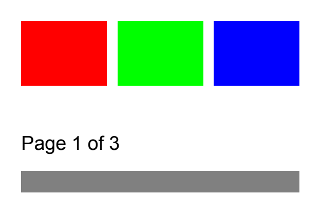

# PDF render demo: pages to images with libpdfium

`harness-demos-pdf-render` is a tour of `render-page`, new in **doc-extract-backend-pdf 0.2.0**. It rasterizes a PDF page into an [image-protocol](https://github.com/egao1980/image-protocol) `stack-image:image` through libpdfium. The PDF backend and its native overlay (pdfium 154.0.8035 from pdfium-binaries, BSD-3-Clause) come from GHCR, along with **image-backend-stb 0.2.1** for the PNG and **crypto-protocol 0.2.0** on crypto-backend-ironclad for the checksums.

Every number comes from the run. The sizes are checked against values worked out by hand, probe pixels against the fixture's colors, every pixel format against image-protocol's `convert-image`, and the PNG against its decoded pixels. The summary line reports the mismatches (100 checks, 0 mismatched). The code is in [`src/demo.lisp`](src/demo.lisp), and [`demo-output.txt`](demo-output.txt) is the output of the last run (macOS arm64, SBCL 2.6.9).



[`output/page-1-150dpi.png`](output/page-1-150dpi.png) (12,818 bytes) is page 0 at 150 dpi as written by the last run.

## Run

```bash
cd harness/pdf-render
cl-repo run -- sbcl --non-interactive --no-userinit --eval '(require "asdf")' \
  --eval '(asdf:load-system "harness-demos-pdf-render")' \
  --eval '(harness-demos-pdf-render:run-demos)' > demo-output.txt 2>&1
```

It needs SBCL and `cl-repo`, and has no model, network or browser step. libpdfium and stb come with their packages' native overlays (linux amd64 and arm64, darwin arm64, windows amd64), so nothing has to be installed. With a warm cache the command takes about 5 seconds on an M-series Mac, and `run-demos` itself under half a second. `run-demos` returns `NIL` if a check fails or a section stops on an error, and CI runs it on Linux, macOS and Windows.

## The input

[`fixtures/pages.pdf`](fixtures/pages.pdf) is three pages (1,527 bytes, uncompressed), written byte by byte for this demo by [`fixtures/make-pages-pdf.py`](fixtures/make-pages-pdf.py) with the Python standard library: no third-party content ([`fixtures/PROVENANCE.md`](fixtures/PROVENANCE.md)).

| Page | Box | Content |
|------|-----|---------|
| 0 | 300 × 200 pt | red, green and blue rectangles, a 50 % gray bar, a line of Helvetica |
| 1 | A4, 595.2756 × 841.8898 pt | a black 2 × 2 inch square one inch from the corner, two lines of Helvetica |
| 2 | 300 × 200 pt CropBox in a 400 × 400 MediaBox, `/Rotate 90` | red left half; a blue strip outside the CropBox |

The plan was to print the PDF from HTML with browser-protocol's `print-pdf` on headless Chrome. The published browser-protocol is 0.1.0, which cannot read Chrome's replies (browser-protocol#1). 0.2.0 is still an open PR (browser-protocol#4), and `print-pdf` takes no paper-size options (browser-protocol#5). So the demo uses a fixture.

## What each section shows

1. **The input.** The fixture's size and SHA-256 (crypto-protocol, Base16 through encoding-protocol), and `extract-metadata` from the same backend: 3 pages, the title.
2. **`render-page` at 72, 150 and 300 dpi.** Every page at each dpi: width × height, pixel count and milliseconds. Each side is points × dpi / 72, to the nearest pixel, halves up: 300 × 200 pt is 625 × 417 at 150 dpi, and A4 is 2480 × 3508 at 300. Probe pixels are checked at every dpi, and every render is checked as opaque. Page 0 has dark text pixels, because pdfium substitutes a font for the non-embedded Helvetica. Page 2 is 200 × 300 on screen, its red half on top, and has no blue pixel because the CropBox hides the strip. A pathname source and an octet source give the same pixels.
3. **Pixel formats.** Page 0 at 150 dpi in `:rgba`, `:rgb`, `:gray` and `:gray-alpha`: bytes per pixel, byte counts and the probe values. Each format is byte for byte `(convert-image rgba format)`. Gray is BT.601 luma (red 76, green 150, blue 29), checked at every probe against the demo's own formula.
4. **Limits.** A4 at 300 dpi with `:max-pixels 4000000` is refused with `stack-image:image-limit-exceeded` (`:pixels`, allowed 4,000,000, actual 8,699,840, format `:pdf`) in 0.2 ms, before any bitmap exists. `render-page` offers no restart there, so the demo sets up its own: `render-smaller` scales the dpi by √(allowed / actual), and the handler invokes it. The retry renders at 203 dpi (1678 × 2374 = 3,983,572 pixels), and the only restart between the handler and the signal is the caller's. `:limits` takes an `image-limits`: `:max-width 2000` refuses 2480 px, and `:max-bytes` 16 MiB refuses a `:gray` render. The check counts the 4-byte BGRA bitmap behind it (34,799,360 bytes), not the 8,699,840-byte gray result.
5. **Errors and restarts.** Index 3 of 3 pages gives `pdf-page-not-found` (index 3, page-count 3, a `doc-extract-error`). Index -1 fails `check-type`, and `store-value 0` renders page 0. For `pdfium-not-loaded`, the demo hides the loaded library the way the backend's missing-library tests do, by binding its internal `*pdfium-loaded*` and `*pdfium-search-enabled*` to `NIL`. It then shows the condition (a `doc-extract-unsupported`) and its restarts `USE-VALUE` and `RETRY`. A handler on `doc-extract-unsupported` returns the caller's own image with `use-value`, and a handler that calls `load-pdfium` and then invokes `RETRY` gets the real page.
6. **PNG.** Page 0 at 150 dpi as `:rgb`, through `encode-image :png` on image-backend-stb, written to `output/page-1-150dpi.png`, with its size and SHA-256. Decoding the file gives the same pixels.

## Issues found

- **egao1980/doc-extract-protocol#9.** The README lists `retry` among the restarts, but no package exports the symbol, so each package that writes `(retry () …)` interns its own. The backend's restart is `DOC-EXTRACT-BACKEND-PDF::RETRY`, and from another package `(invoke-restart 'retry)` signals `No restart RETRY is active`. The demo finds the restart by name, as the backend's own test does.
- **egao1980/doc-extract-backend-pdf#16.** The `pdfium-not-loaded` report repeats its message: `libpdfium is not loaded format PDF: libpdfium is not loaded`.

No step was dropped or worked around.
